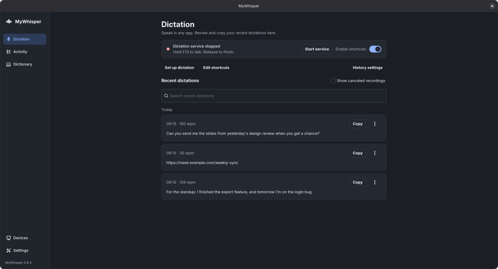
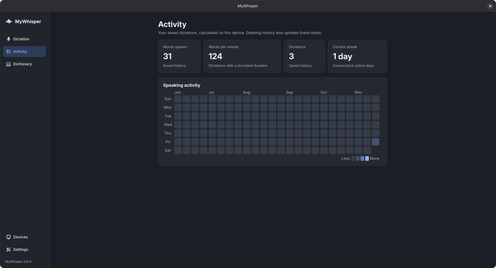
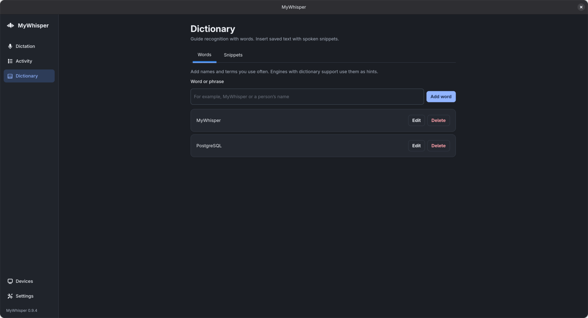
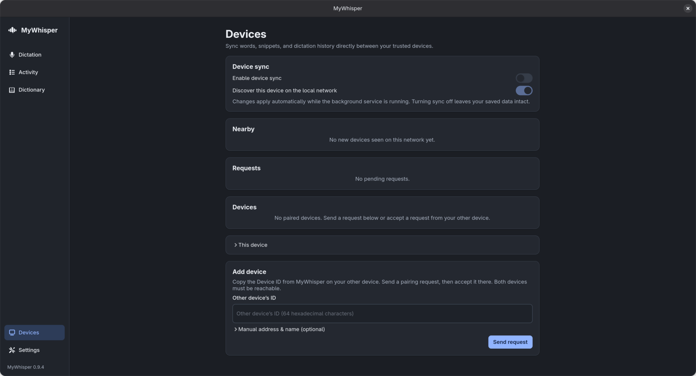
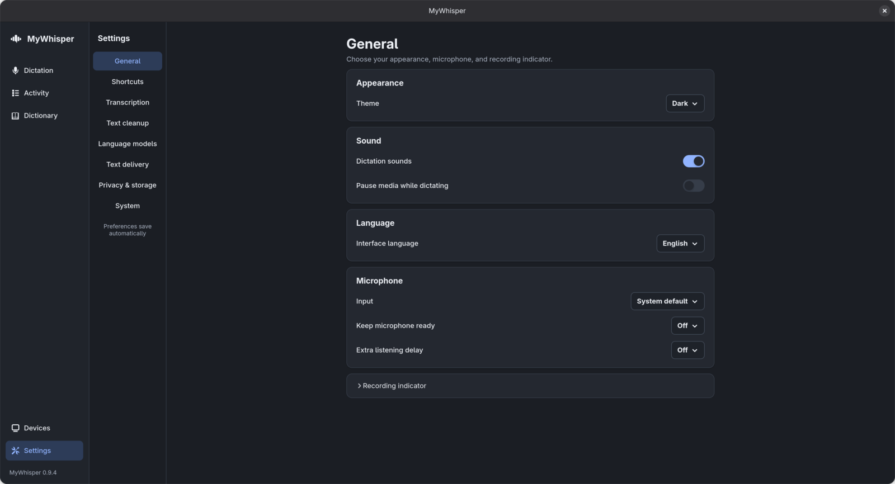

<div align="center">
  
  <h1>MyWhisper</h1>
  <p>Voice dictation for Linux: press a key, talk, and clean text lands in any app.</p>
</div>

Hold a shortcut and speak. A small pill shows your voice level while you
talk, and the text is typed into whatever app has focus. Transcribe on your
own machine, on a self-hosted server, or with a cloud provider. An optional
language model can clean up the result. History stays in an encrypted local
database and syncs over your LAN with your other MyWhisper devices, desktop
or [phone](https://github.com/aaronroquefonseca/MyWhisperMobile).

GTK4 + Rust, Linux/Wayland-first.

## Screenshots

<table>
  <tr>
    <td align="center" width="50%">
      <br />
      <sub><b>Dictation</b><br />status and recent dictations</sub>
    </td>
    <td align="center" width="50%">
      <br />
      <sub><b>Activity</b><br />words, speed, and streaks</sub>
    </td>
  </tr>
  <tr>
    <td align="center" width="50%">
      <br />
      <sub><b>Dictionary</b><br />custom words and spoken snippets</sub>
    </td>
    <td align="center" width="50%">
      <br />
      <sub><b>Devices</b><br />encrypted LAN sync between your devices</sub>
    </td>
  </tr>
  <tr>
    <td align="center" colspan="2">
      <br />
      <sub><b>Settings</b><br />speech-to-text chain, text cleanup, shortcuts, and more</sub>
    </td>
  </tr>
</table>

Screenshots come from the isolated preview (no real data):
`cargo run --example ui_preview -- <page> dark en --png <file>`.

For fast local PR testing and PR-based release notes, see
[the development workflow](docs/DEVELOPMENT.md).
Release notes use dated, release-linked headings and the categories in [the release configuration](.github/release.yml).

## Pieces

- **Service** (`mywhisper --service`): headless background engine —
  global hotkeys, capture, transcription, sync, heartbeat. Runs as a
  systemd user service (`mywhisper.service`).
- **Pill**: overlay with live mic visualizer, streaming transcription
  preview and an animated Processing state. Wayland layer-shell where
  the compositor has it; otherwise an X11 overlay window (X11 sessions,
  and GNOME through XWayland: always on top, never focused); a plain
  window as the last resort.
- **App** (`mywhisper`): desktop window — Dictation (health + recent
  history), Activity (stats + heatmap), Dictionary (words + spoken
  snippets), Devices, and Settings (including transcription and text cleanup).
- **Speech to Text**: chained options, top-down fallback. Local
  whisper (HTTP :8080), sherpa online/offline (websocket :6006/:6007,
  incl. the English Bark 3.0 family), Whistle CLI, self-hosted
  (OpenAI-compat http or sherpa-protocol ws/wss, optional bearer
  token), cloud (OpenAI/Groq/Mistral/Gemini/Deepgram). One local server at a time; lazy start with catch-up.
  Dictionary words accompany HTTP transcription requests as provider-specific
  spelling hints (subject to provider budgets; Mistral/Deepgram: up to 100
  terms, with an additional conservative byte budget for Deepgram Nova-3).
  Sherpa ws/wss uses server-configured hotwords; its wire protocol has no
  per-request dictionary field. Snippet replacements stay on this device.
- **Sync**: serverless device-to-device over encrypted TCP
  (Noise_XX, ed25519 session proofs), mDNS discovery, LWW merge.
- **State**: single encrypted `state.db` (`~/.local/share/mywhisper/`),
  SQLCipher with the key in the OS keychain.

## Shortcut sources

The default is **hold Ctrl+Super** (talk while held, release to type).
Any key or combo works: add more in Settings → Shortcuts, each with Hold,
Toggle or Smart. Portal desktops show their own dialog to confirm or change
the key.

Settings → Shortcuts → Shortcut source picks how hotkeys are heard:
the desktop portal (KDE, GNOME 48+, Hyprland), X11 (XInput2) on X11
sessions, or keyboard devices (`/dev/input`, needs the `input` group).
Automatic tries them in that order.

Compositor keybinds also work with any source (or alone, with
"Compositor keybinds only"): bind a key to `mywhisper --dictate ACTION`. F13 below is only
an example key (handy on macro keyboards).

```kdl
// niri: toggle (press starts, next press stops)
binds { F13 { spawn "mywhisper" "--dictate" "toggle"; } }
```

```conf
# Sway: hold to talk
bindsym F13 exec mywhisper --dictate press
bindsym --release F13 exec mywhisper --dictate release

# Hyprland: hold to talk
bind = , F13, exec, mywhisper --dictate press
bindr = , F13, exec, mywhisper --dictate release
```

`press`/`release` follow the first binding's mode (hold, toggle or
smart); `toggle` starts and stops; `cancel` discards the dictation.

## Install (private releases)

Tagged versions ship binary tarballs on the private GitHub Release
(`gh` authenticated with an account that can see the repo).

Arch (latest release):

```bash
./packaging/arch/update.sh
```

Specific version:

```bash
./packaging/arch/update.sh 0.9.0
```

The script downloads the tarball, bumps the PKGBUILD, runs
`makepkg -si` (needs sudo), then enables the user service:

```bash
systemctl --user enable --now mywhisper.service
```

NixOS — flake input (HTTPS + token, no SSH needed):

```nix
mywhisper.url = "github:aaronroquefonseca/MyWhisper?dir=packaging/nixos";
```

SSH alternative:

```nix
mywhisper.url = "git+ssh://git@github.com/aaronroquefonseca/MyWhisper?dir=packaging/nixos";
```

```nix
imports = [ mywhisper.nixosModules.default ];
services.mywhisper.enable = true;
```

Plus a GitHub token in nix.conf for the private tarball
(`access-tokens = github.com=...`) and the per-release `fetchzip`
hash (see comments in `packaging/nixos/flake.nix`).

## Build

```bash
cargo fmt && cargo check && cargo build
cargo test
```

## Run (dev)

```bash
./target/debug/mywhisper --service   # background engine
./target/debug/mywhisper             # desktop app
```

Preview the UI with disposable sample data:

```bash
cargo run --example ui_preview -- home light en
cargo run --example ui_preview -- settings dark es 'Speech to Text'
cargo run --example ui_preview -- home light en Preferences --smoke
```

See [UI/UX audit, design references, and control behavior](docs/UI_UX.md).

If text has stray marks or missing strokes with the GPU renderer, try
GTK's Cairo renderer for the desktop window:

```bash
GSK_RENDERER=cairo ./target/debug/mywhisper
```

Close the existing desktop window first so the new process takes effect.
This workaround only selects the renderer for that launch; it does not
change system graphics settings or the background service.

## System deps (Arch)

gtk4, gtk4-layer-shell, libadwaita, alsa-lib, pkgconf.

### Packaging audit checks

The Nix flake builds the source against its locked Nixpkgs instead of fetching
an unverified private binary. Its wrapper supplies Adwaita/hicolor fallback
icons, the default paste/capture tools, certificates and the resolver executable.
The NixOS module enables nix-ld and CPU/Vulkan loader libraries for downloaded
upstream engines. Remote-only setups can disable `enableDownloadedRuntimes`.
CUDA inference additionally requires a compatible NVIDIA driver and CUDA/cuDNN
libraries; supplying the Vulkan loader establishes startup, not GPU inference.

Run `nix build ./packaging/nixos#checks.x86_64-linux.desktop`,
`nix build ./packaging/nixos#checks.x86_64-linux.symbolic-logo` and
`nix build ./packaging/nixos#checks.x86_64-linux.whisper-vulkan-loader` for the
scoped clean NixOS package/service, GTK 4.22 SVG and exact downloaded loader
checks. The full release-audit shutdown/privacy/provider requirements remain on
the integration branch.

Candidate archives include authenticated dependency notices and SHA-256 sums.

## License

MyWhisper is licensed under the [MIT License](LICENSE).

Portions adapted from OpenWhispr retain its MIT copyright and license notice in
[packaging/notices/OpenWhispr.txt](packaging/notices/OpenWhispr.txt).
Third-party components retain their own licenses. Release archives and installed
packages include the project license, third-party notices, and their inventory.

Speech models are not bundled: they download on demand under their own
licenses. The Bark 3.0 packs are Conway Research's
[Underdog Bark 3.0](https://huggingface.co/ConwayResearch/Underdog-Bark-3.0/tree/85db2ad18ab41e534a222ee253c29191d77ed919),
[Plus](https://huggingface.co/ConwayResearch/Underdog-Bark-3.0-Plus/tree/d4fab2f8b95681e5ad3cfb4e8c5f4e0c009b3deb)
and [Clean](https://huggingface.co/ConwayResearch/Underdog-Bark-3.0-Clean/tree/6d34ed8639b2b9a33e764acf06748519bbb950cf)
under [CC BY 4.0](https://creativecommons.org/licenses/by/4.0/) at those
revisions (later revisions are CC BY-NC 4.0 and are not used), in unofficial
ONNX int8 conversions by `velddev` pinned to exact commits. Each pack installs
with its NOTICE, LICENSE and conversion README, and Settings shows the source,
license, modification note and warranty disclaimer. The models are provided
as-is, without warranties.

Downgrading below the first Bark release: older builds read a Bark selection
as NVIDIA. Saving any setting there drops the Bark choice, so after upgrading
again NVIDIA stays selected; installed Bark packs remain on disk and can be
chosen again from the Bark tab.
